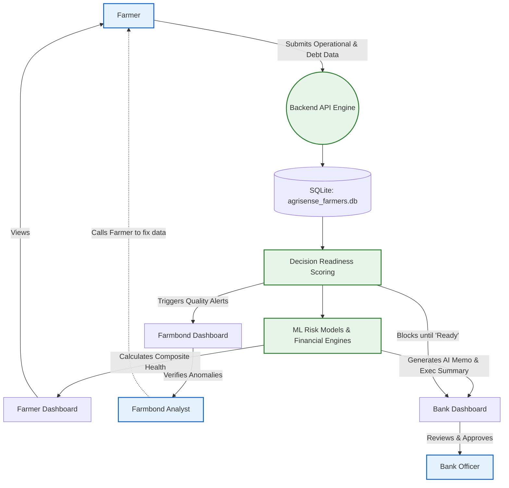
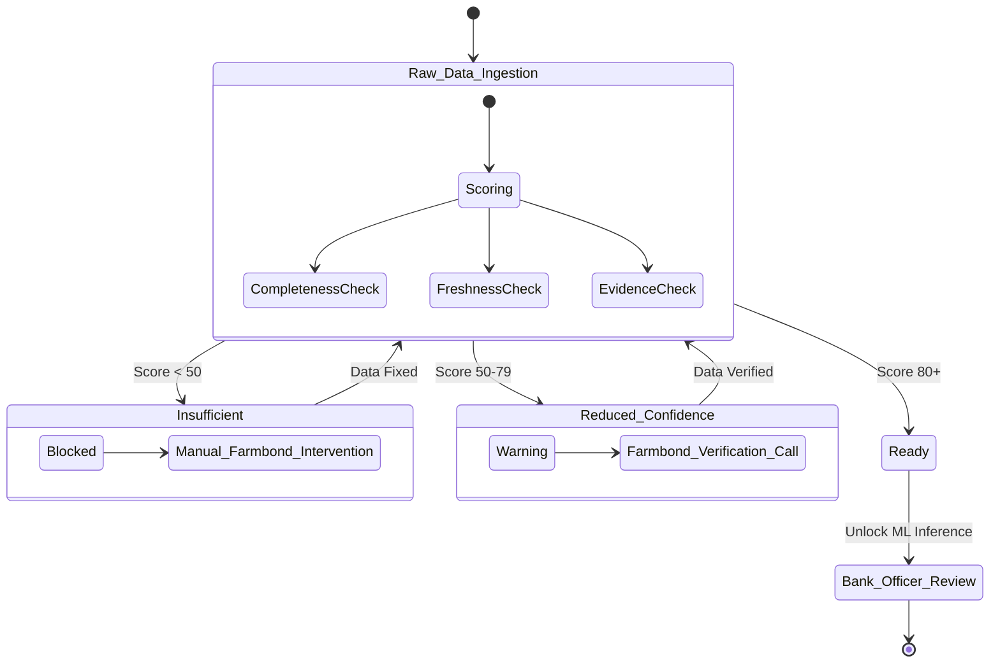

# Product Requirements Document (PRD): AgriSense

**Product Lead:** Uday Kiran  
**Status:** MVP Completed / API Backend Constructed  

---

## 1. Executive Summary
Farming is a business dictated by unpredictable weather, generational history, and highly fragmented paper trails. When a farmer applies for a loan, they aren't just sending data—they are putting their livelihood on the line. Yet, the current financial system treats them as numbers in a black box. 

AgriSense is an explainable AI decision-support platform designed to restore trust between agricultural borrowers and risk-averse financial institutions. Inspired by centralized digital portals (like India's DigiLocker), it transforms messy, physical farm data into a standardized, holistic debt profile. By enforcing a strict "Decision Readiness" layer and providing distinct transparent views for the Farmer, the Middle Layer (Farmbond), and the Bank, AgriSense ensures capital is deployed fairly and safely.

## 2. Product Vision & North Star
**Vision:** "Empowerment through Verification & Transparency." We believe that highly accurate AI is useless if the humans involved do not trust it. AgriSense builds that trust.
**North Star Metric:** *Time-to-Verified-Decision* - The total time elapsed from a farmer's initial data submission to the bank officer's final, auditable approval/rejection.

## 3. Problem Statement
The agricultural lending market is suffering from a massive empathy and data gap:
*   **The Farmer's Reality:** They are exhausted by redundant paperwork, inheriting land records that are physically scattered, and deeply frustrated when their loan is rejected without any human explanation.
*   **The Bank's Reality:** Bank officers actually *want* to deploy capital, but they are terrified of regulatory backlash and bad debt. They cannot legally or morally trust a "black box" algorithm to make decisions for them. 

The result is a stalemate: blind rejections caused by fragmented data and zero auditable reasoning.

## 4. Goals & Non-Goals
**Goals:**
*   Provide a single, dignified entry-point for farmers to aggregate their holistic debt (farm + housing).
*   Protect the bank by enforcing a strict algorithmic evaluation of data quality ("Decision Readiness") before generating risk predictions.
*   Generate 100% transparent, explainable ML risk assessments that read like a human analyst wrote them.

**Non-Goals:**
*   Fully automated, straight-through loan approvals (we augment humans; we do not replace them).
*   Building a proprietary core-banking ledger.

## 5. Users & Personas (The Human Element)
**1. The Farmer (The Applicant)**
*   *Emotional State:* Anxious, distrustful of AI, tired of being judged by algorithms they don't understand.
*   *The Need:* A unified, simple dashboard to understand their total debt capacity and preliminary eligibility without repeating paperwork.

**2. Farmbond (The Middle Layer / Analyst)**
*   *Emotional State:* Overwhelmed by trying to reconcile messy physical data against strict bank compliance rules. 
*   *The Need:* A stable system to evaluate the raw data quality of the application and monitor the overall ML model performance before passing data to the bank.

**3. The Bank Officer (The Approver)**
*   *Emotional State:* Highly defensive of their career; risk-averse.
*   *The Need:* An evidence-preparation engine that provides an Executive Summary, historical repayment data of similar profiles, and an auditable AI decision memo that they can legally stand behind.

---

## 6. End-to-End User Journey (Role-Based Triangulation)
Unlike traditional linear funnels, the MVP execution uses a **Role-Based Triangulation** journey where all three personas interact with the same underlying truth via specialized dashboards. 

---

## 7. Product Scope
### 7.1 MVP (Executed)
*   Role-Based Dashboards (Farmer, Farmbond, Bank)
*   Decision Readiness Engine (Data Integrity Scoring)
*   Explainable ML Risk Engine & Deterministic Financial Calculator
*   Investment Simulator & Liquidity Stress Tests

### 7.2 Phase 2 (Planned)
*   **"DigiLocker" Secure Document Upload:** Encrypted cloud storage for uploading physical land deeds (deferred from MVP due to strict timelines).
*   **Linear State Workflow Engine:** Building a formal ticketing system for application tracking.

### 7.3 Out of Scope
*   Direct loan disbursement.

---

## 8. Functional Requirements

### 8.1 Farmer Workflow (FW)

**FR-FW-01: Consolidated Debt & Health Dashboard**
*   **Priority:** P0 (Critical)
*   **Description:** A dashboard where farmers can view their unified financial health, environmental risk, and AI recommendations without confusing banking jargon.
*   **Acceptance Criteria:**
    *   *Given* a farmer logs in, *Then* the system must instantly display their composite financial health score (0-100), environmental risk score, and a plain-text AI recommendation (e.g., "Proceed with conditions").

### 8.2 Farmbond Workflow (CAW)

**FR-CAW-01: Data Quality & Model Evaluation Monitoring**
*   **Priority:** P0 (Critical)
*   **Description:** A monitoring interface used by Farmbond analysts to manually verify the integrity of the underlying data and the performance of the ML models before the bank trusts the system.
*   **Acceptance Criteria:** 
    *   *Given* an analyst accesses the dashboard, *Then* they must be able to view system-wide model performance metrics and data quality alerts to prevent algorithmic bias.

### 8.3 Bank Officer Workflow (BOW)

**FR-BOW-01: Executive Summary & Explainable AI Prediction**
*   **Priority:** P0 (Critical)
*   **Description:** An underwriting dashboard that consolidates all risk factors into a single executive view, featuring a calibrated risk probability and a generative AI decision memo.
*   **Acceptance Criteria:**
    *   *Given* a Bank Officer reviews a profile, *Then* it must output a calibrated risk probability alongside a human-readable memo summarizing the exact SHAP feature importances driving that score.

### 8.4 Advanced Analysis Workflow (AAW)

**FR-AAW-01: Multi-Variable Investment Simulator**
*   **Priority:** P1 (High)
*   **Description:** A "what-if" calculator that lets the bank safely simulate how new major purchases will impact the farmer's future financial health.
*   **Acceptance Criteria:** 
    *   *Given* an officer inputs a hypothetical loan, *Then* the system must recalculate and display the new projected risk score and DSCR delta.

**FR-AAW-02: Macro-Metric Liquidity Stress Test**
*   **Priority:** P1 (High)
*   **Description:** A tool that tests whether a farmer will run out of cash by subtracting their operating expenses from their projected revenue and real-world government subsidies.
*   **Acceptance Criteria:**
    *   *Given* a profile is selected, *Then* the system must calculate a 12-month liquidity score identifying exact months where net cash drops below zero.

---

## 9. Application Lifecycle & The Decision Readiness Engine
Rather than relying on a manual ticketing workflow (Draft -> Submitted), the MVP architecture executes **Algorithmic State Management** via the `decision_readiness.py` microservice. The system dynamically classifies an application's state based on three vectors: *Evidence Reliability*, *Data Freshness*, and *Completeness*.

**State Definitions:**
1.  **Insufficient (Blocked):** Missing core financials or critical operational data. The system strictly blocks ML inference to prevent hallucination.
2.  **Reduced Confidence (Warning):** Data exists but is stale (e.g., documents > 12 months old) or lacks high evidence reliability. Forces the Farmbond layer to manually intervene.
3.  **Ready (Approved):** High completeness and freshness. The application is unlocked for the Bank Officer to review the AI Decision Memo.

---

## 10. Data Requirements
*   **10.1 Data Inputs:** System strictly parses 15 engineered ML features (including operational yields and environmental metrics) and 10 deterministic financial ratios (including DSCR, LTV, DTI).
*   **10.2 Data Sources:** Farmer inputs, Swedish Drought Index (macro), EU CAP database (macro).
*   **10.3 Synthetic Data (MVP Constraint):** To bypass strict PII restrictions during MVP development, behavioral profiles for 1,000 baseline farmers were synthesized using real-world macro conditions.

---

## 11. Risk & Decisioning Architecture (The Contract)
AgriSense acts as an evidence-preparation engine. It does not make decisions; it algorithmically prepares a mathematical contract for the bank officer.

**11.1 Inputs (The Raw Material):**
*   **15 Operational & Environmental ML Features:** 
    1) `farm_size_acres`, 2) `crop_type`, 3) `years_in_farming`, 4) `cibil_score` (UC Score), 5) `has_tractor`, 6) `has_irrigation`, 7) `has_insurance`, 8) `rainfall_mm`, 9) `temperature_celsius`, 10) `drought_index_severity`, 11) `flood_risk`, 12) `commodity_price_change_pct`, 13) `diesel_price`, 14) `fertilizer_price`, 15) `government_subsidies_value`.
*   **10 Deterministic Financial Ratios:** 
    1) Debt-to-Income (DTI), 2) Debt Service Coverage Ratio (DSCR), 3) Loan-to-Value (LTV), 4) Operating Margin, 5) Asset Coverage, 6) Working Capital, 7) Current Ratio, 8) Cash Flow Margin, 9) Interest Coverage, 10) Revenue per Hectare.
*   **External Macro Data:** Swedish Drought Index API, EU Common Agricultural Policy (CAP) subsidy grids.

**11.2 Processing (The Engine):**
*   **Gatekeeping:** The `decision_readiness` engine scans inputs for completeness and freshness.
*   **Inference:** Data is passed to 3 distinct Random Forest algorithms (`credit_risk_model`, `debt_capacity_model`, `repayment_model`).
*   **Calibration:** Raw model outputs are subjected to *Platt Scaling* to convert arbitrary ML risk scores into true, bank-ready probabilities of default (0-100%).
*   **Stress Testing:** Deterministic engines (`liquidity_analysis`) simulate seasonal cash flow drops against real EU CAP subsidy payout dates.
*   **Interpretability Mapping:** During MVP evaluation, the system successfully mapped that the *Drought Index* dominates financial ratios (28.6% overall feature importance).

**11.3 Outputs (The Deliverable):**
*   **Calibrated Risk Probabilities:** e.g., 85% probability of successful repayment.
*   **Debt Capacity Limit:** Exact SEK/kr limit calculated based on DSCR limits.
*   **SHAP Interpretability:** Per-prediction feature importance (e.g., "This score was penalized by 12% due to high local flood risk").
*   **AI Decision Memo:** A generative AI (Gemini) summary translating the math into a human-readable underwriting memo.

---

## 12. Non-Functional Requirements (NFRs)
*   **12.1 Performance:** The entire AI inference pipeline (including SHAP generation and Gemini API calls) must return a completed Decision Memo within 3.5 seconds to maintain a seamless underwriting experience.
*   **12.2 Availability:** The Farmer Application Wizard must maintain 24/7 availability (99.9% uptime). The Analyst and Bank Officer dashboards are only strictly bound to 99.9% uptime during standard banking hours (08:00 - 18:00 CET).
*   **12.3 Security:** All internal and external endpoints require strict JWT authentication and role-based access control (RBAC).
*   **12.4 Privacy:** GDPR compliance required; strict obfuscation of farmer PII is mandated before data is passed to the ML models or the Gemini API.
*   **12.5 Auditability:** The AI Decision Memo generation must lock the inference timestamp and the specific version of the ML model used to ensure the bank's reasoning is permanently auditable.

## 13. Technical Architecture
*   **Frontend:** Rapid prototyping UI (Streamlit) featuring role-based routing (Farmer/Farmbond/Bank).
*   **Backend:** API-first microservices framework (FastAPI) containing specialized services (`decision_readiness.py`, `scenario_analysis.py`, `synthetic_generator.py`).
*   **Persistence:** SQLite (`agrisense_farmers.db`) managing farmer profiles.

## 14. API / Integration Requirements
*   **Internal:** Frontend must communicate exclusively with the FastAPI backend via RESTful endpoints (`/predict`, `/financial-analysis`, `/investment-simulator`, `/decision-readiness`).
*   **External:** Integration with Gemini API for generative decision memos and SHAP for explainability metrics.

## 15. Error & Edge-Case Handling
*   **Edge Case:** The system detects an outdated Land Title Deed.
*   **Handling:** The `decision_readiness` API instantly downgrades the profile to `Reduced Confidence`, flashing a yellow warning state to the Bank Officer indicating that the Farmbond middle-layer must step in to manually verify.

## 16. Success Metrics & Product Analytics
*   **Task Success:** *Explainability Adoption Rate* - The percentage of AI-generated decision memos used verbatim by the Bank Officer.
*   **Trust Metric:** The reduction in "Insufficient" profiles hitting the Bank Officer's desk.

## 17. Risks, Assumptions & Dependencies
*   **Risk:** The MVP UI does not feature direct physical document uploading (DigiLocker vision deferred to Phase 2).
*   **Mitigation:** The rigorous `Decision Readiness` algorithmic scoring acts as the fail-safe to flag unverified or manually entered data anomalies.

## 18. Testing & Validation Strategy
*   **ML Validation:** The risk models (Credit Risk, Repayment, Debt Capacity) must maintain >90.0% ROC-AUC and 99.4% Precision on a synthesized holdout set of 1,000 stress-test farmers.

## 19. Rollout / Deployment Plan
*   MVP deployed via Docker/Streamlit for immediate CEO validation.

## 20. Open Questions & Future Roadmap
*   *Open Question:* What is the exact legal liability shift if a Bank Officer blindly approves a loan based *solely* on the AI Decision Memo without manual review?
*   *Roadmap:* Build a true state-transition ticketing workflow engine for formal application tracking (Phase 2).
